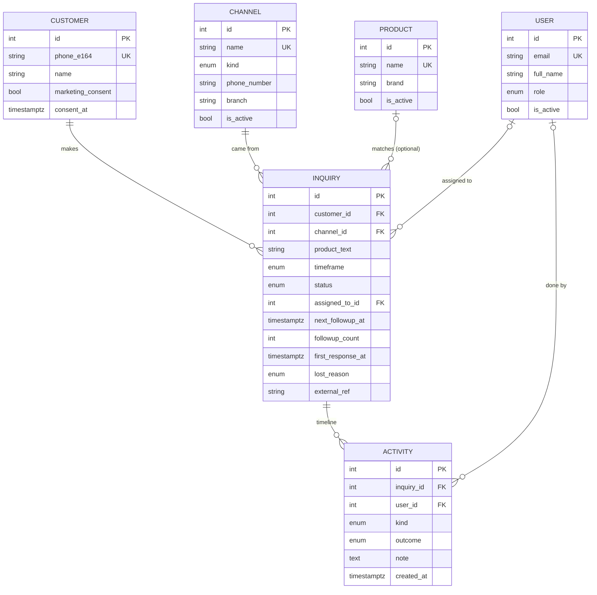
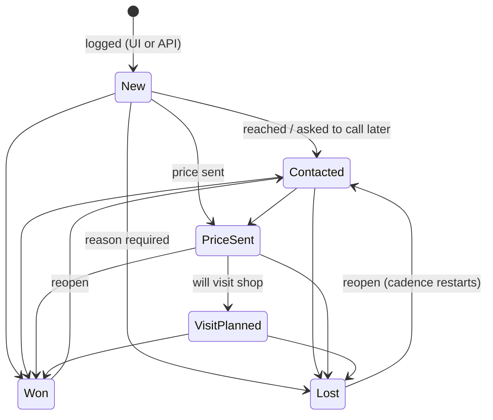

# Architecture

## Goals

1. **No inquiry is lost.** Every lead has an owner (or shows up as unassigned) and either a
   next follow-up time or a "needs decision" flag.
2. **Fast capture.** The coordinator types four things: number, product, time period, source.
3. **One customer, many channels.** Customers are identified by their normalised phone number.
4. **Cheap and simple to run.** One small container plus PostgreSQL. No queue, no cache and no
   front-end build step.
5. **Ready to automate later.** The intake API means WhatsApp Cloud API / Meta webhooks, web
   forms or a chatbot can feed the same pipeline without schema changes.

## Components

```mermaid
flowchart LR
  subgraph Staff
    C[Coordinator] -->|logs inquiries| UI
    S[Sales] -->|call list, log results| UI
    M[Manager] -->|reports, CSV, settings| UI
  end
  Ext[Website form / chatbot / Meta webhook bridge] -->|POST /api/v1/inquiries + X-API-Key| API
  UI[FastAPI + Jinja pages] --> SVC[Service layer]
  API[JSON API] --> SVC
  SVC --> DB[(PostgreSQL)]
  UI -. wa.me / tel: links .-> WA[WhatsApp / phone on staff device]
```

- **Routers** (`app/routers`) handle HTTP only: parse forms, check permissions, render pages.
- **Services** (`app/services`) hold every business rule: validation, de-duplication,
  status transitions, follow-up scheduling and reporting. They are tested without HTTP.
- **Transactions:** services only `flush()`. The router, API or CLI commits once per request,
  so each action is all-or-nothing.

## Data model



Key decisions:

| Decision | Why |
|---|---|
| `customers.phone_e164` is unique | The same person on Hotline 2 and Instagram is one customer, so their history is in one place. Numbers are parsed with Google's `phonenumbers` (default region LK). |
| Customer is separate from Inquiry | A customer can ask about several products over time; each inquiry has its own pipeline and owner. |
| `activities` is append-only | Gives the timeline and an audit trail (who changed status, who reassigned, when). Reports can be rebuilt from it. |
| Enums stored as `VARCHAR` values | Readable in SQL and CSV, and new values need no `ALTER TYPE` migration. Validated in Python. |
| All timestamps `timestamptz` in UTC | Converted to Asia/Colombo only for display and for the "today" calculation. A custom column type rejects naive datetimes. |
| `next_followup_at` is denormalised on the inquiry | Call lists are one indexed query: `(status, next_followup_at)` and `(assigned_to_id, next_followup_at)`. |
| `(channel_id, external_ref)` is unique | Makes automated intake idempotent: webhook retries never create duplicates. |
| `product_text` plus an optional `product_id` | Staff can type anything; if the text matches the catalogue it is normalised, so reports group cleanly. |
| Deterministic constraint names | Alembic migrations behave the same on PostgreSQL and SQLite (used by tests). |

## Inquiry lifecycle



Every contact attempt (call, WhatsApp, social message, shop visit) increments
`followup_count`, sets `first_response_at` the first time, and schedules the next follow-up
from the cadence for the inquiry's time period (`app/services/followup.py`). A "note" is
recorded on the timeline but doesn't count as contact.

## Security

- Session cookie signed with `SECRET_KEY`, `SameSite=Lax`, `Secure` in production, session
  rotated on login.
- CSRF token on every form post; a strict Content-Security-Policy (no inline scripts);
  `X-Frame-Options: DENY`.
- bcrypt password hashes; login throttling (8 failures per 15 minutes per IP and email).
- Role checks on every route; sales can only work their own or unassigned leads.
- CSV export is manager-only and protected against formula injection.
- The API is disabled unless `API_KEY` is set; keys are compared in constant time.
- Production refuses to start with the default secret or with SQLite.

## Scaling path

The current design comfortably handles a few thousand inquiries a month on the smallest
Railway setup. When needed:

1. **More traffic:** set `WEB_CONCURRENCY`, and move login throttling to Redis if you run
   several replicas.
2. **Automatic capture from WhatsApp:** connect the WhatsApp Business Platform (Cloud API)
   numbers to a small webhook bridge that calls `POST /api/v1/inquiries` with
   `external_ref = message id`. No schema change is needed.
3. **Stock and price lookup:** add a service that queries your ERP and shows stock on the
   inquiry page.
4. **Reminders (done):** `app/services/digests.py` sends the morning call list and the
   evening report as Web Push notifications. A minute-by-minute in-process scheduler claims
   a `job_runs (job, date)` row before sending, so each job runs once per day across restarts
   and workers. VAPID keys are generated on first use and stored in `app_settings`.
